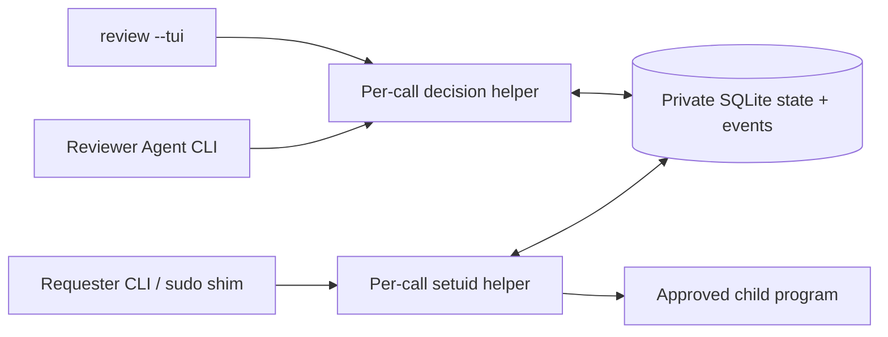

# Runtime and trust boundaries

The public CLI is unprivileged. Cobra, Bubble Tea, Bubbles and Lip Gloss are linked only into `agsudo`; the helper exposes a fixed JSON transport and never loads UI, models or user plugins. Both binaries are Go and Linux only.

The helper runs only for an operation or the lifetime of one foreground execution. For execution, the CLI replaces itself with the helper, so the caller's terminal, signals and exit status reach the monitor without relaying. A watch/TUI is an optional user-owned foreground client polling short helper calls; there is no daemon, socket listener, service manager dependency or external database server. Each state mutation acquires `BEGIN IMMEDIATE`; event insertion and state update share that transaction, with WAL and `synchronous=FULL`.

ELF executables are opened, rehashed, and executed through `/proc/self/fd/3`. Shebang scripts use the verified original path to preserve `$0` and interpreter resource lookup. The latter check does not eliminate concurrent path-replacement races. Arguments, script dependencies, cwd contents and external services are not frozen; authorization is not a filesystem sandbox. Unsupported newer database schemas are rejected without rewriting their version.

The kernel's real UID/GID identify callers of the setuid helper. Caller-controlled environment, labels and JSON cannot supply an authenticated identity. Production uses `/etc/agsudo/config.json`; the config, state directory and all ancestors must be protected root-owned paths. Configured reviewers can read all requests and approve arbitrary commands, including their own when also allowed to submit. This is a collaboration control, not isolation between hostile processes sharing a UID.

The caller snapshots explicitly selected files before crossing the privilege boundary. The helper validates bounded UTF-8 data and hashes, but never reads arbitrary context paths as root. It resolves command names using the configured secure PATH and records a target identity and sanitized environment. Request specs never change after creation. Roots of trust include the kernel, root configuration, installed binaries, system executables and configured approvers.

Execution claims a grant atomically, verifies the executable again, and spawns a child with the target UID, GID and supplementary groups. The helper stays as its parent, forwards signals, and records the result. There is no global approval ticket: identical future commands require their own requests. The process monitor is identified using boot ID and `/proc` start time to avoid PID reuse. Its disappearance makes execution uncertain, not retryable.

When the helper is the terminal's foreground job, the command inherits the same session and streams. Interactive shells establish normal foreground process groups and job control, and keyboard signals reach the command directly rather than being relayed again. Without a controlling terminal, or from a background job, the child gets its own process group for signal forwarding and the terminal is left alone. The monitor restores terminal settings after exit unless the caller's shell has moved another live job to the foreground, and keeps its creating OS thread alive for Linux's parent-death signal semantics. An abrupt monitor death kills its direct child via `PDEATHSIG`; this is not a cgroup and cannot guarantee cleanup of deliberately detached descendants. No PAM/login session, resource sandbox, GUI authentication or terminal I/O recording is provided.

As with sudo, commands get the caller's umask combined with `0022`; the helper itself uses `0077`. The static build resolves local users and groups from system account files; it does not provide LDAP/SSSD NSS or PAM account/session policy. Programs relying on ELF `$ORIGIN` or their original `/proc/self/exe` location need particular care with descriptor execution; executable hashes alone do not attest dependencies.

The sudo shim covers PATH lookup only. Root callers, absolute paths to other privilege tools, preexisting NOPASSWD sudo, polkit, Docker access and shell overrides remain separate deployment concerns. AG-sudo neither modifies these permissions nor claims to constrain them.

Development builds use a separate build tag and executable. They require real/effective UID/GID equality and refuse UID 0; only the current user may be the target. Their database path is supplied explicitly in `AGSUDO_DEV_STATE`. The production binary contains no such path override.

Audit is append-only through the public API, not cryptographically protected against root or offline database edits. Context and reasoning fields can contain sensitive or adversarial text; terminal views escape control characters, while machine JSON preserves source material. The research export deliberately preserves original decisions and suggestions rather than treating human approval as a safety ground truth.
