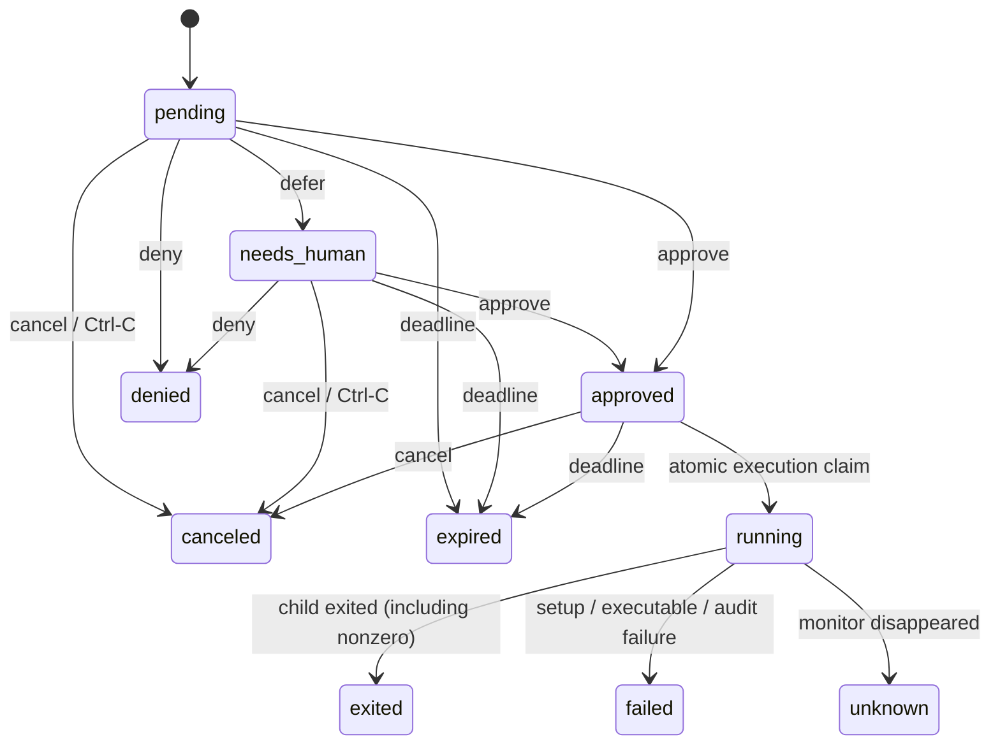

# CLI protocol

Command usage lives in `agsudo exec --help` (requesters), `agsudo review --help`
(reviewers) and `agsudo COMMAND --help`. This page is the reference for output,
states, events, exit codes, and limits. The CLI and helper are always installed
together, so the protocol is unversioned.

## Control output

With `--json` (anywhere before `--`), control commands print their result to
stdout: `request`, `show`, `approve`, `deny`, `defer` and `cancel` print a
request; `review` prints an array of requests; `doctor` prints the caller's
mode and permissions. Errors go to stderr with a nonzero exit status:

```json
{"error":{"code":"conflict","message":"cannot approve req_3f9c2a71d04b8e65: it is canceled"}}
```

The Go structures in `internal/api/types.go` define the schema. A request
contains the argument vector, resolved executable and its SHA-256, cwd, target
identity and groups, reason, context snapshots, session, digest, state,
timestamps, decisions and the execution result. Help is always text.

The digest is SHA-256 of Go's canonical JSON encoding of the immutable `spec`.
Reuse the supplied digest rather than reserializing JSON. Digest matching does
not freeze the filesystem or external services.

Commands run with a fixed environment built from the spec: `PATH` (the
configured secure path), `HOME`, `USER`, `LOGNAME` and `SHELL` of the target,
`LANG=C.UTF-8`, `SUDO_UID`, `SUDO_GID`, `SUDO_USER`, `SUDO_COMMAND`,
`AGSUDO_REQUEST_ID`, and the caller's `TERM` when it is a plain terminal name.

`exec`, `wrap` and the sudo shim do not support `--json`; command stdout and
stderr remain the command's own.

## States



Approval never starts a command by itself: a waiting `sudo` or `agsudo exec` starts it, or the requester runs the same command again later, at most once. Ctrl-C (SIGINT or SIGQUIT) while waiting cancels the request. Any other end of a wait — SIGTERM, SIGHUP, SIGKILL — leaves the request as it is until it expires. Submitting a command that matches one of the owner's unused requests — same spec and session, ignoring reason and context — returns that request instead of creating another, so running the same command again resumes it. A recent denial of that command is returned the same way, so it is reported instead of asked again. Only a submission with a new reason or context asks anew: it replaces a pending match (canceled as "replaced by" the new request) or answers a denial, while approved and needs_human matches are still returned. A new request records the denied or replaced one it follows in `prior`. `sudo -n` sets `reuse_only`: it runs an approved match and never creates a request.

`running` starts with consuming the grant, before spawning the program. `command_pid` appears after successful spawn. Thus a crash during launch can become `unknown`, even if the program never started. Never retry such a grant automatically.

Decisions made without a terminal or with `--json` set `pending_only`, so `needs_human` requests are left to people; such callers must also pass `--expect-digest` to approve and `--reason` to deny or defer. At a terminal, `approve` shows the request and asks for confirmation. Approving a request whose session equals the caller's `AGSUDO_SESSION` is `forbidden`, and decisions record that session. These are guardrails against agent mistakes, not authentication. Same-action approve/deny retries from the same UID are idempotent while that final decision is still current. Opposing decisions conflict. `defer` updates the suggestion while keeping the immutable command; its state becomes `needs_human`. Manual approval retains that suggestion for later comparison. Suggestions are attribution, not verified identities or safety ground truth.

No always-on process is necessary: lifecycle checks run during queries, decisions and execution, so expiry and lost executions produce events without a daemon. An execution monitor is identified by kernel PID, process start time and boot ID.

## Events

`agsudo --json events` prints the audit trail, one event per line, and
`--follow` keeps waiting for new events:

```json
{"sequence":12,"type":"request.approved","actor_uid":1000,"request":{"id":"req_...","state":"approved"}}
```

Examples abbreviate the request, which is the full request as it was after the
event; lifecycle events (expiry, lost executions) have `actor_uid` 0. Event types are `request.created`, `request.approved`, `request.denied`, `request.deferred`, `request.canceled`, `request.expired`, `execution.claimed`, `execution.started`, `execution.exited`, `execution.failed` and `execution.lost`.

Sequences are global and increasing; a filtered user's stream may have gaps. Resume with `--after` and the last processed sequence, keeping the same filters, and handle replay idempotently. No output or keystrokes are stored.

## Exit status and errors

Control commands: `0` success, `1` operation failure, `2` invalid CLI usage, `130` interrupted (for example `events --follow` or the TUI). JSON errors contain a code such as `usage`, `forbidden`, `not_found`, `conflict`, `invalid_input`, `invalid_user`, `invalid_command`, `command_not_found`, `queue_full`, `configuration` or `helper_unavailable`.

Execution, like sudo: the command's exit status, or `128 + N` when it is killed by signal N. If the command does not start — denied, expired, canceled, already used, not permitted, or a setup failure — the exit status is `1` and stderr says why. An interrupted wait exits with `128 + N` for signal N. `show` and audit events distinguish these cases from a command that itself exits 1.

Limitations: at most 256 unconsumed requests per user; at most 256 argv elements / 64 KiB total; executable hashing is capped at 256 MiB; TTL is administrator bounded to at most 24 hours. Context is limited to 8 UTF-8 snapshots, 64 KiB each and 256 KiB total. The internal helper IPC is capped at 1 MiB. No bulk wildcard grant, ambient credential cache, automatic retries, networking, or internal model loop is part of v1.
