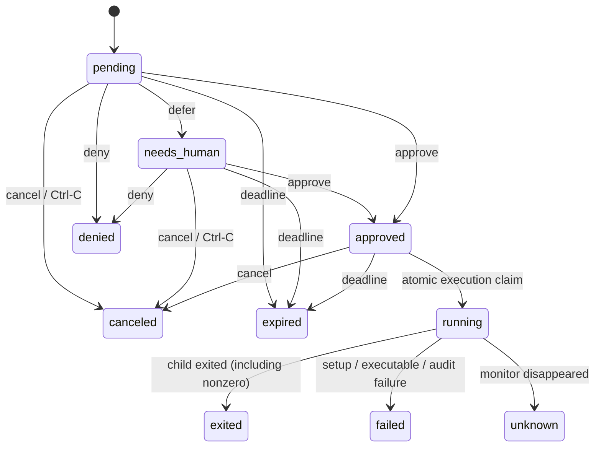

# CLI protocol v1

Command usage lives in `agsudo help --requester`, `agsudo help --reviewer` and
`agsudo COMMAND --help`. This page is the reference for output, states, events,
exit codes, and limits. Protocol JSON has a fixed `schema_version: 1`.

## Control output

With `--json` (anywhere before `--`), control commands print success to stdout:

```json
{"schema_version":1,"data":{"id":"req_...","state":"pending","digest":"..."}}
```

Errors go to stderr, with nonzero exit status:

```json
{"schema_version":1,"error":{"code":"conflict","message":"cannot approve request in state canceled"}}
```

`request`, `show`/`status`, `approve`, `deny`, `defer` and `cancel` return a request in `data`. `review --json` returns `data.requests`. `doctor` returns mode and caller permissions. The Go structures in `internal/api/types.go` define the complete schema. A request contains the full argument vector, resolved executable and SHA-256, cwd, target identity/groups, exact clean environment, reason, snapshots, session, digest, states, timestamps and decisions. Help is always text.

The digest is SHA-256 of Go's canonical struct JSON encoding of the immutable `spec`. Consumers should reuse the supplied digest rather than independently reserializing JSON. Digest matching does not freeze the filesystem or external services.

`exec`, `wrap` and the sudo shim do not support `--json`; command stdout/stderr remain command streams. Use `request`, `status` and event streams for machine state.

## States



Approval never starts a command by itself. A waiting `sudo` or `agsudo exec` starts it; otherwise the requester runs `agsudo exec --request ID`, at most once. Ctrl-C (SIGINT or SIGQUIT) while waiting cancels the request. Any other end of a wait — SIGTERM, SIGHUP, SIGKILL — leaves the request as it is until it expires. Submitting a request whose digest equals one of the owner's unused (pending, needs_human or approved) requests returns that request instead of creating another; since the digest covers the session, running the same command again in the same session resumes it.

`running` starts with consuming the grant, before spawning the program. `command_pid` appears after successful spawn. Thus a crash during launch can become `unknown`, even if the program never started. Never retry such a grant automatically.

Decisions with `--json` set `pending_only`, so `needs_human` requests are left to people, and `approve` with `--json` requires `--expect-digest`. Approving a request whose session equals the caller's `AGSUDO_SESSION` is `forbidden`. These are guardrails against agent mistakes, not authentication. Same-action approve/deny retries from the same UID are idempotent while that final decision is still current. Opposing decisions conflict. `defer` updates the suggestion while keeping the immutable command; its state becomes `needs_human`. Manual approval retains that suggestion for later comparison. Suggestions and metadata are attribution, not verified identities or safety ground truth.

No always-on process is necessary: lifecycle checks run during queries, decisions and execution, so expiry and lost executions produce events without a daemon. An execution monitor is identified by kernel PID, process start time and boot ID.

## Events

`watch --json` and `audit export` emit raw event objects, one per line:

```json
{"schema_version":1,"sequence":12,"at":"2026-01-01T00:00:00Z","type":"request.approved","request_id":"req_...","owner_uid":1000,"actor":{"uid":1000,"label":"agent:reviewer"},"request":{"state":"approved"}}
```

Examples abbreviate the request snapshot. Event types are `request.created`, `request.approved`, `request.denied`, `request.deferred`, `request.canceled`, `request.expired`, `execution.claimed`, `execution.started`, `execution.exited`, `execution.failed` and `execution.lost`.

Sequences are global and monotonically increasing; a filtered user's stream may have gaps. Resume with `--after` using the last processed sequence, keeping the same filters. Events replay existing history first, then follow new events. Handle replay idempotently. No output or keystrokes are stored.

## Exit status and errors

Control commands: `0` success, `1` operation failure, `2` invalid CLI usage, `130` interrupted watch/TUI. JSON errors contain a stable code such as `usage`, `forbidden`, `not_found`, `conflict`, `invalid_input`, `invalid_user`, `invalid_command`, `command_not_found`, `queue_full`, `configuration`, `helper_unavailable` or `protocol_version`.

Execution, like sudo: the command's exit status, or `128 + N` when it is killed by signal N. If the command does not start — denied, expired, canceled, already used, not permitted, or a setup failure — the exit status is `1` and stderr says why. An interrupted wait exits with `128 + N` for signal N. `status` and audit events distinguish these cases from a command that itself exits 1.

Limitations: at most 256 unconsumed requests per user; at most 256 argv elements / 64 KiB total; executable hashing is capped at 256 MiB; TTL is administrator bounded to at most 24 hours. Context is limited to 8 UTF-8 snapshots, 64 KiB each and 256 KiB total. The internal helper IPC is capped at 1 MiB. No bulk wildcard grant, ambient credential cache, automatic retries, networking, or internal model loop is part of v1.
