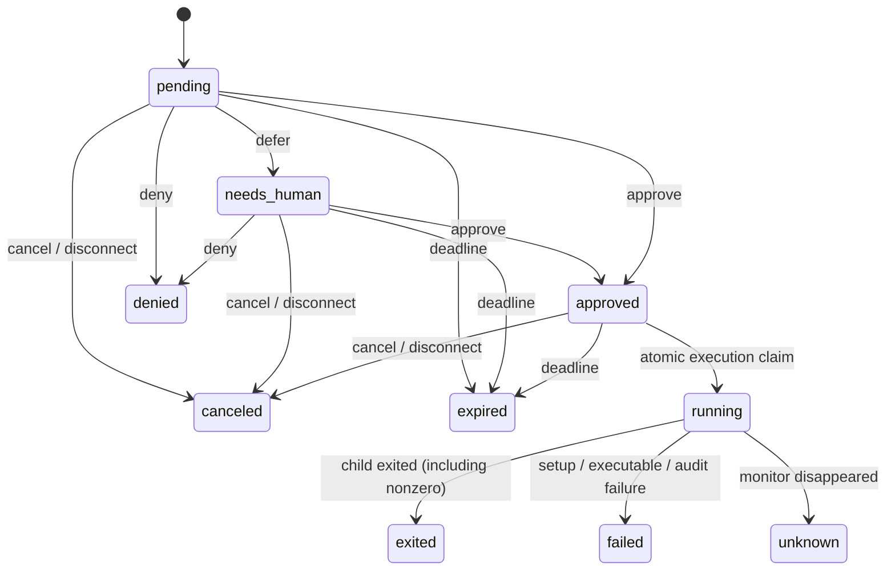

# CLI protocol v1

Use `agsudo help COMMAND` for command flags, `agsudo help --requester` for the
requesting Agent workflow, and `agsudo help --reviewer` for the reviewing Agent
workflow. Protocol JSON has a fixed `schema_version: 1`.

## Control output

For automated calls, put `--json` first (`agsudo --json approve REQUEST_ID`)
so even flag parsing errors use JSON. Help is always text.

Success goes to stdout:

```json
{"schema_version":1,"data":{"id":"req_...","state":"pending","digest":"..."}}
```

Errors go to stderr, with nonzero exit status:

```json
{"schema_version":1,"error":{"code":"conflict","message":"cannot approve request in state canceled"}}
```

`request`, `show`, `status`, `approve`, `deny`, `defer` and `cancel` return a request in `data`. `review --json` returns `data.requests`. `doctor` returns mode and caller permissions. The Go structures in `internal/api/types.go` define the complete schema. A request contains the full argument vector, resolved executable and SHA-256, cwd, target identity/groups, exact clean environment, reason, snapshots, session, digest, states, timestamps and decisions.

The digest is SHA-256 of Go's canonical struct JSON encoding of the immutable `spec`. Consumers should reuse the supplied digest rather than independently reserializing JSON. Digest matching does not freeze the filesystem or external services.

`exec` and `wrap` do not support `--json`; command stdout/stderr remain command streams. Use `request`, `status` and event streams for machine state. The sudo-compatible path stays quiet until approval has been pending for about two seconds, then prints only `sudo: approval pending; see 'sudo --help'` once. `agsudo exec` uses the analogous `agsudo help --requester` hint.

## States



`running` starts with consuming the grant, before spawning the program. `command_pid` appears after successful spawn. Thus a crash during launch can become `unknown`, even if the program never started. Never retry such a grant automatically.

Same-action approve/deny retries from the same UID are idempotent while that final decision is still current. Opposing decisions conflict. A request can be executed at most once. `defer` updates the suggestion while keeping the immutable command; its state becomes `needs_human`. Manual approval retains that suggestion for later comparison. Suggestions/metadata are attribution, not verified identities or safety ground truth.

No always-on process is necessary: lifecycle checks use kernel PID + process start time + boot ID, and occur during queries, decisions and execution. Watches also sweep outstanding requests, so expiration and disconnection produce events without a daemon. Detached requests ignore the original submitting process's lifetime. Once an execution client starts waiting, its disconnection cancels that attempt.

## Events

`watch --json`, `review --watch --json`, and `audit export` emit raw event objects, one per line:

```json
{"schema_version":1,"sequence":12,"at":"2026-01-01T00:00:00Z","type":"request.approved","request_id":"req_...","owner_uid":1000,"actor":{"uid":1000,"label":"agent:reviewer"},"request":{"state":"approved"}}
```

Examples abbreviate the request snapshot. Event types include `request.created`, `request.approved`, `request.denied`, `request.deferred`, `request.canceled`, `request.expired`, `execution.claimed`, `execution.started`, `execution.exited`, `execution.failed`, `execution.lost`.

Sequences are global and monotonically increasing; a filtered user's stream may have gaps. Resume with `--after` using the last processed sequence, keeping the same filters. Events replay existing history first, then follow new events. Handle replay idempotently. No output or password keystrokes are stored.

## Exit status and errors

Control commands: `0` success, `1` operation failure, `2` invalid CLI usage, `130` interrupted watch/TUI. JSON errors contain a stable code such as `usage`, `forbidden`, `not_found`, `conflict`, `invalid_input`, `invalid_user`, `command_not_found`, `queue_full`, `configuration`, `helper_unavailable` or `protocol_version`.

Execution: the command's exit code, or `128 + signal` when signaled. Before execution, `124` means approval expired, `125` setup/infrastructure failure or an already-consumed grant, `126` cancellation, and `127` authorization unavailable/denied or program launch failure. Ctrl-C during waiting yields `130`. An actual command can itself exit with these numbers; `status --json` and audit distinguish that case.

Limitations: at most 256 unconsumed requests per user; at most 256 argv elements / 64 KiB total; executable hashing is capped at 256 MiB; TTL is administrator bounded to at most 24 hours. Context is limited to 8 UTF-8 snapshots, 64 KiB each and 256 KiB total. The internal helper IPC is capped at 1 MiB. No bulk wildcard grant, ambient credential cache, automatic retries, networking, or internal model loop is part of v1.
